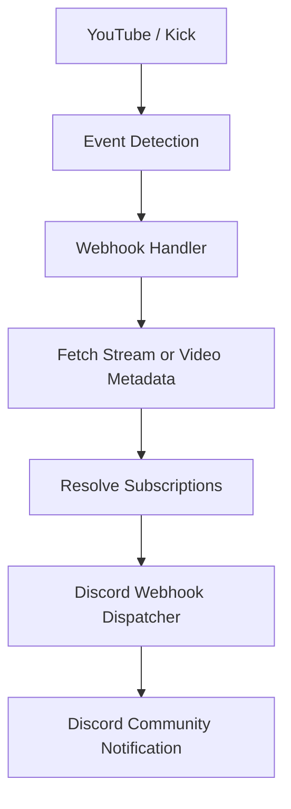

# 📡 Feed Notifier

An event-driven Discord notification bot that integrates streaming platforms like **YouTube** and **Kick** to deliver real-time stream and video notifications to Discord communities.

Feed Notifier helps communities stay updated whenever their favorite creators go live or publish new content.

---

## ✨ Features

- **YouTube Integration**
  - Real-time notifications using YouTube WebSub.
  - Supports live stream notifications.
  - Supports newly published video notifications.
  - Channel-based subscriptions.

- **Kick Integration**
  - Kick API integration for livestream monitoring.
  - Retrieves livestream metadata, including title, category, viewer count, and thumbnail.
  - Stream notifications for subscribed creators.

- **Discord Integration**
  - Sends rich Discord embed notifications.
  - Supports Discord webhook-based delivery.
  - Configurable notifications for individual Discord servers.

- **Database**
  - PostgreSQL database powered by Neon.
  - Drizzle ORM for database queries and schema management.
  - Persistent streamer and Discord subscription records.

- **Backend**
  - Built with Node.js.
  - Modular integration architecture.
  - Structured logging with Pino.

---

## 🛠️ Tech Stack

| Technology | Purpose |
|---|---|
| Node.js | Backend runtime |
| Discord.js | Discord bot integration |
| PostgreSQL | Persistent data storage |
| Neon | Serverless PostgreSQL |
| Drizzle ORM | Database ORM |
| YouTube WebSub | Real-time YouTube event notifications |
| Kick API | Kick livestream data |
| Express.js | Webhook server |
| Pino | Structured logging |

---

## 📁 Project Structure

```text
Feed_Notifier/
├── src/
│   ├── integrations/
│   │   ├── kick/
│   │   │   ├── kick.api.js
│   │   │   └── kick.webhook.js
│   │   └── youtube/
│   │       └── ...
│   ├── ...
├── .env.example
├── .gitignore
├── drizzle.config.js
├── index.js
├── package.json
└── README.md
```

---

## ⚙️ Installation

### Prerequisites

- Node.js
- PostgreSQL database (Neon recommended)
- Discord application and bot
- YouTube API credentials
- Kick Developer application credentials

### 1. Clone the repository

```bash
git clone https://github.com/Punit9464/Feed_Notifier.git
cd Feed_Notifier
```

### 2. Install dependencies

```bash
npm install
```

### 3. Configure environment variables

Create a `.env` file in the project root using `.env.example` as the reference.

```bash
cp .env.example .env
```

Configure the required credentials and application settings in your `.env` file.

**Never commit your `.env` file or expose your API credentials.**

### 4. Configure the database

Set up your PostgreSQL database and provide the connection string in your environment configuration.

Use the project's Drizzle configuration to apply the database schema.

### 5. Start the Application

You can start Feed Notifier using either of the following methods.

#### Option 1: Using the Start Script

```bash
npm run start
```

#### Option 2: Manual Setup

Push the database schema using Drizzle Kit and then start the application:

```bash
npx drizzle-kit push
node index.js
```

Make sure your environment variables are configured correctly before starting the application.
---

## 🔔 Notification Workflow



---

## 🔐 Environment Configuration

The application uses environment variables for configuration and secrets.

Refer to `.env.example` for the required variables, including database credentials, platform API credentials, Discord configuration, and webhook settings.

---

## 🚀 Future Enhancements

- Support for additional streaming platforms.
- Improved notification customization.
- Advanced subscription management.
- Persistent event deduplication.
- Enhanced monitoring and logging.

---
